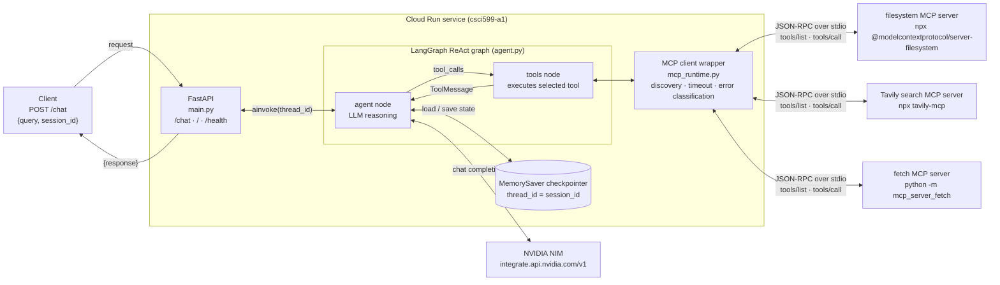
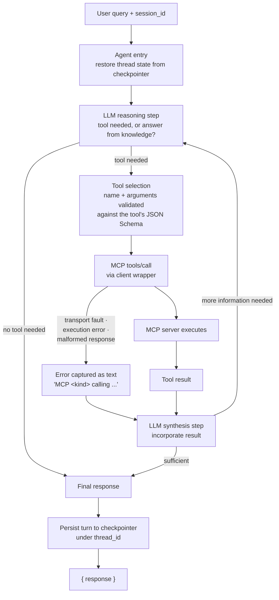
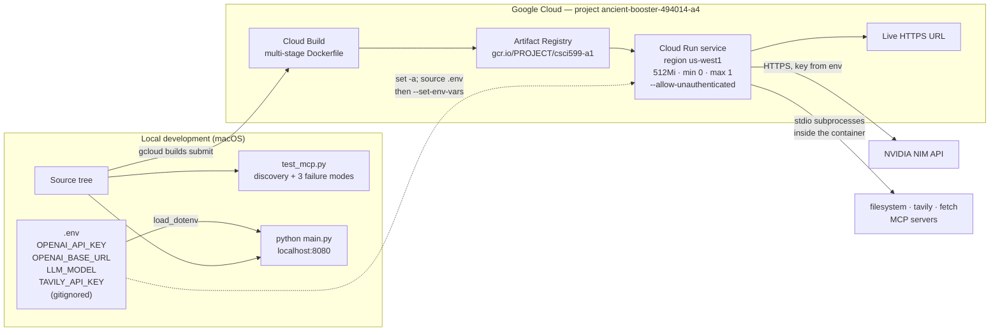

# CSCI 599 Assignment 1 — Tool-Using Agent with MCP Integration

A LangGraph ReAct agent that discovers and invokes tools across **three MCP servers**,
keeps per-session conversational memory in a LangGraph checkpointer, and serves a
`POST /chat` endpoint on Google Cloud Run.

- **Framework:** LangGraph + FastAPI + `langchain-mcp-adapters`
- **LLM backend:** NVIDIA NIM (OpenAI-compatible endpoint), configurable to OpenAI by env var alone
- **Live URL:** <https://csci599-a1-lhja6z4s2q-uw.a.run.app>

## MCP servers integrated

| Server | Package | Transport | Tools discovered | Why it's here |
|---|---|---|---|---|
| filesystem | [`@modelcontextprotocol/server-filesystem`](https://github.com/modelcontextprotocol/servers/tree/main/src/filesystem) | stdio (Node) | 14 | Required pairing. Reads/writes under `/app/workspace`. |
| tavily | [`tavily-mcp`](https://github.com/tavily-ai/tavily-mcp) | stdio (Node) | 5 | Required pairing. Web search for anything outside the model's knowledge. |
| fetch | [`mcp-server-fetch`](https://github.com/modelcontextprotocol/servers/tree/main/src/fetch) | stdio (Python) | 1 | **Additional server.** Retrieves and cleans one specific URL. Chosen because it composes with Tavily: search surfaces a link, fetch reads the page behind it, which exercises multi-step tool chaining rather than adding a second unrelated capability. |

All three are external open-source projects, used as published and cited above.

## Diagram 1 — System architecture



## Diagram 2 — Tool invocation flow

The loop-back is the point: after every tool result the LLM reasons again and may
call another tool before it is allowed to emit a final answer.



## Diagram 3 — Deployment topology



Keys never enter the image or the repository. They live in the local `.env`, are
sourced into the deploying shell, and reach the service only through `--set-env-vars`.

## Setup

Requires Python 3.13 and Node.js 18+ (the filesystem and Tavily servers are Node packages).

```bash
python3 -m venv venv && source venv/bin/activate
pip install -r requirements.txt

cp .env.example .env     # then fill in your two keys
```

You need two free keys:

- **NVIDIA NIM** — <https://build.nvidia.com> → *Get API Key* (starts `nvapi-`). Free tier, ~40 req/min.
- **Tavily** — <https://app.tavily.com> → API key (starts `tvly-`). Free tier is sufficient.

`LLM_MODEL` defaults to `nvidia/nemotron-3-ultra-550b-a55b`. The faster, cheaper
alternative is `nvidia/nemotron-3.5-lightning-30b-a3b` — both are the models the
assignment names as tested. The full catalogue is public:

```bash
curl -s https://integrate.api.nvidia.com/v1/models | python3 -m json.tool | grep '"id"'
```

To switch to OpenAI instead, unset `OPENAI_BASE_URL` and set `LLM_MODEL=gpt-5`.

## Run locally

```bash
set -a; source .env; set +a
python main.py                       # serves on $PORT, default 8080
```

```bash
# Turn 1
curl -s localhost:8080/chat -H 'Content-Type: application/json' \
  -d '{"query":"What is in notes.txt?","session_id":"demo"}'

# Turn 2 — same session, depends on turn 1
curl -s localhost:8080/chat -H 'Content-Type: application/json' \
  -d '{"query":"What did I just ask you?","session_id":"demo"}'
```

`GET /` reports which MCP servers were reached at startup and which failed. `GET /health`
is the liveness probe — deliberately not `/healthz`, which Cloud Run's frontend
intercepts before it reaches the container.

## Verify

```bash
python test_mcp.py
```

Runs without an LLM key. Checks `tools/list` against all three servers, a real
`tools/call` round trip, and each of the three required failure modes — including a
deliberately unreachable server binary. Expected: `14 passed, 0 failed`.

## Deploy

```bash
./deploy.sh
```

Builds through Cloud Build, pushes to Artifact Registry via the `gcr.io` compatibility
path, deploys to Cloud Run in `us-west1`, and prints the live URL.

`--max-instances 1` keeps the in-memory checkpointer on a single instance. Memory is
intentionally non-durable: it is lost when the instance is recycled, which the
assignment permits for A1.

## Error handling

`mcp_runtime.py` wraps every discovered tool. Failures become text the model reads and
reasons about instead of exceptions that end the request:

| Failure mode | Handling |
|---|---|
| Connection / transport | Per-server discovery is isolated — an unreachable server is recorded in `/` and the agent runs with the remaining servers. Mid-call transport faults are caught and unwrapped from nested anyio `ExceptionGroup`s. |
| Tool execution error | Returned to the LLM as `MCP tool execution error calling '<tool>' on the <server> server: …`. The system prompt tells the model to treat these as failures, not data. |
| Malformed / invalid response | Non-serialisable results are coerced to text; schema mismatches are classified as `malformed response`. A tool advertised without an input schema falls back to an empty schema instead of crashing discovery. |

Every tool call is also bounded by `MCP_TOOL_TIMEOUT` (default 60s) so a hung server
cannot hold an HTTP request open indefinitely.

## Cost disclosure

- **NVIDIA NIM:** $0 — free developer tier.
- **Tavily:** $0 — free tier credits.
- **Cloud Run:** scale-to-zero with `min-instances 0`; idle cost is effectively zero.
  Cloud Build and Artifact Registry storage are the only recurring charges, cents per
  month at this size. Billed against the $50 USC education credit; expected total for
  this assignment is well under $1.

## Layout

```
main.py             FastAPI app, /chat contract, startup wiring
agent.py            LLM construction, system prompt, ReAct graph, MemorySaver
mcp_runtime.py      manifest loading, tools/list discovery, error hardening
mcp_config.json     MCP server manifest (${VAR} placeholders, no secrets)
test_mcp.py         verification suite
Dockerfile          multi-stage build, non-root runtime, Node for the stdio servers
deploy.sh           build + deploy, keys passed from the shell
workspace/          filesystem MCP server root
```

## Attribution

MCP server implementations are external open-source projects, linked in the table
above and used unmodified. Framework use (LangGraph, langchain-mcp-adapters, FastAPI,
Cloud Run tooling) is course-canonical and carried by the import statements.
